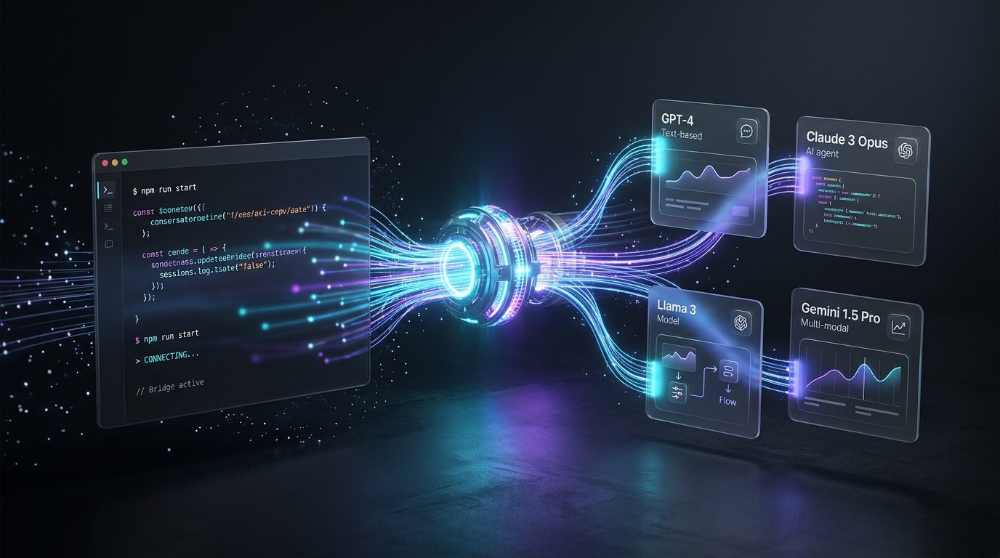
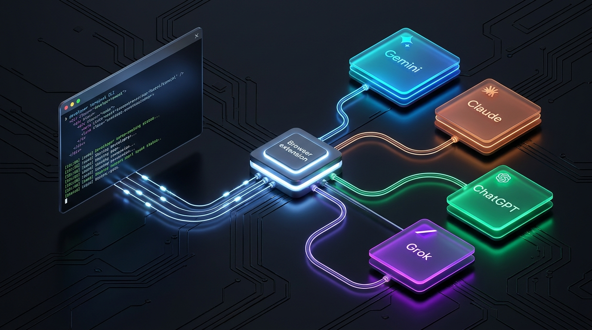

<div align="center">



# 🌐 AI Web Bridge
### Multi-AI Browser Orchestrator & Local CLI Bridge
**Use Gemini Argon, Claude Sonnet/Opus/Haiku, ChatGPT, Grok, and Blackbox directly from your terminal or AI coding agent — 100% Free, Zero API Keys, Hands-Free.**

[](LICENSE)
[]()
[](https://www.python.org/downloads/)
[]()
[]()
[]()

</div>

---

> [!WARNING]
> **Important Notice on Consumer Web Sessions:**
> Automating consumer web sessions may conflict with some providers' terms of service and can trigger rate limits, CAPTCHA challenges, or account flags. Use responsibly, avoid abusive polling rates, and adhere to each service provider's acceptable use policies.

---

## 💡 What is AI Web Bridge?

**AI Web Bridge** turns your signed-in browser tabs into high-performance, cost-free AI copilots for your coding terminal or AI agent (**Antigravity**, **Cursor**, **Claude Code**, **Aider**, etc.).

Instead of paying expensive API token rates or hitting restrictive rate limits, AI Web Bridge orchestrates tasks across your active web sessions in Chrome or Edge, monitors generation streams, extracts structured code, verifies results against automated compiler/test checks, and persists project history across AI handoffs.

---

## 🏛️ System Architecture & Workflow



The system operates across three tightly integrated layers:
1. **Developer CLI & Orchestrator (`bridge`):** Builds strict prompt envelopes, passes file paths by reference (sparing context tokens), verifies code output with automated checks, and manages project handoffs.
2. **Local Broker & Native Messaging Host:** Authenticates requests via local loopback sockets (`127.0.0.1`) and routes tasks securely to the browser extension without exposing secrets.
3. **Zero-Click Browser Extension:** Runs in your browser, claims pending jobs, switches to the correct provider tab, enters the prompt, detects streaming completion, and extracts formatted output without user intervention.

---

## ⚡ 60-Second Quick Start

### 1. Install Dependencies
```bash
git clone https://github.com/Mohit20057/AI-web-bridge.git
cd AI-web-bridge
pip install -r requirements.txt
```

### 2. Register the Local Extension Host
Link your browser with the local broker:
```bash
python bridge/argon_bridge.py --extension-setup
```

### 3. Load the Browser Extension
1. Open Chrome or Edge and navigate to `chrome://extensions`.
2. Enable **Developer mode** (top-right toggle).
3. Click **Load unpacked** and select the [`browser-extension/`](browser-extension/) directory.

---

## 🔄 Project Lifecycle & Handoff Commands

AI Web Bridge provides built-in project state tracking and cross-AI handoff in `.bridge/`:

```bash
# Initialize bridge tracking and generate rolling HANDOFF.md
bridge init --goal "Build PulseTask Kanban board"

# Sync outside changes (auto-detects manual user edits and logs to ledger)
bridge sync

# Check project health (Current state + Next steps, max 15 lines)
bridge status

# Seamlessly hand off project context to another AI model
bridge handoff --to claude --goal "Refactor state engine"
```

### Handoff Rules
- **Ledger:** `.bridge/ledger.jsonl` records append-only facts (`git_before`, `git_after`, `verify`, `status`).
- **Rolling Summary:** `.bridge/HANDOFF.md` maintains a compact ~1500 token state summary, auto-compacting older events.
- **Auto-Sync:** Every command compares working tree and HEAD against the last checkpoint to track user modifications.

---

## 🚀 Multi-Stage Pipeline Runner (`--pipeline`)

Run entire multi-AI relays end-to-end with automated verification and cross-review:

```bash
bridge --pipeline pipeline.yaml
```

### `pipeline.yaml` Example
```yaml
stages:
  - provider: claude
    template: architect
    out: spec.md
    task: "Design the PulseTask application contract"

  - provider: chatgpt
    template: engine
    in: spec.md
    out: engine.js
    verify: "node --check engine.js"

  - provider: gemini
    template: ui
    in: [spec.md, engine.js]
    out: index.html
    verify: "node -e \"require('fs').readFileSync('index.html')\""
```

- **Pass by Reference:** Stages exchange files on disk; the agent sees only a single summary line per stage:
  `OK job=stg2 stage=2/3 out=engine.js lines=668 status=COMPLETE verify=PASS`
- **Verify & Fixer Loop:** If verification fails, the orchestrator dispatches only the trimmed error (max 15 lines) to the fixer role in the same chat thread, applies unified diffs or complete file fallbacks, and re-runs the check (up to `--max-retries 2`).

---

## 🤖 Supported AI Providers & Models

| Provider | ID | Default Web URL | Key Supported Models |
| :--- | :--- | :--- | :--- |
| **Google Gemini** | `gemini` | `https://gemini.google.com/app` | **Argon**, Pro, Flash, Flash-Lite |
| **Anthropic Claude** | `claude` | `https://claude.ai/new` | **Claude Sonnet**, Opus, Haiku |
| **OpenAI ChatGPT** | `chatgpt` | `https://chatgpt.com/` | **GPT-4o**, o1, Canvas |
| **xAI Grok** | `grok` | `https://grok.com/` | **Grok**, Grok Vision |
| **Blackbox AI** | `blackbox` | `https://www.blackbox.ai/` | **Blackbox AI** |

---

## 🏛️ Council Mode (Consensus & Synthesis)

Evaluate tough architectural questions or security reviews through multi-model debate:

```bash
bridge --council --providers gemini,claude,chatgpt --compare-provider claude --prompt "Evaluate WebSockets vs SSE"
```
- **Round 1 (Independent):** Models propose answers in isolation under schema: `Recommendation`, `Reasoning`, `Risks`, `Confidence`.
- **Round 2 (Synthesis):** Evaluator receives anonymized proposals (`Candidate A/B/C`) and provides a definitive decision with rejected alternatives.

---

## 🔒 Security & Privacy Guarantees

- **No Passwords or Cookies Exported:** The bridge never touches, extracts, or exports your session cookies or tokens.
- **Local Loopback Only:** All CLI-extension communication is bound strictly to `127.0.0.1`.
- **Data Isolation:** Prompts wrap previous outputs strictly inside `<<<PREV_START>>>` and `<<<PREV_END>>>` data envelopes.

---

## 📄 License

This project is licensed under the [Apache 2.0 License](LICENSE).
Copyright (c) 2026 Mohit20057.
